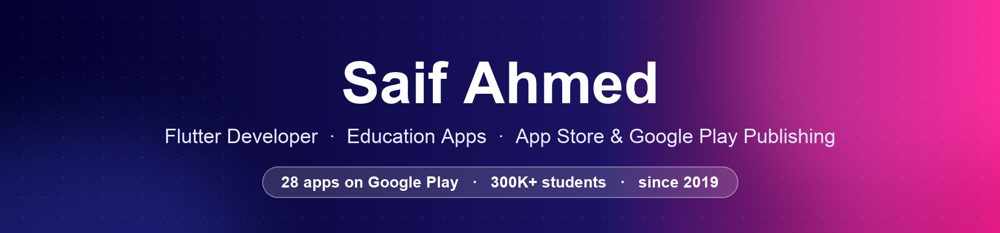
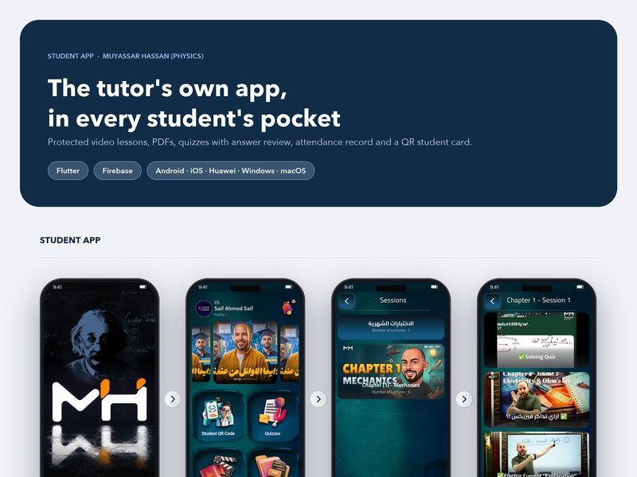
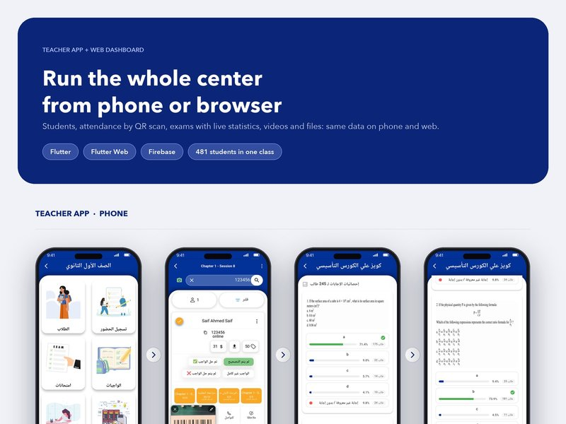
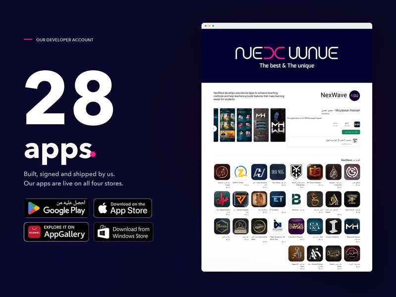
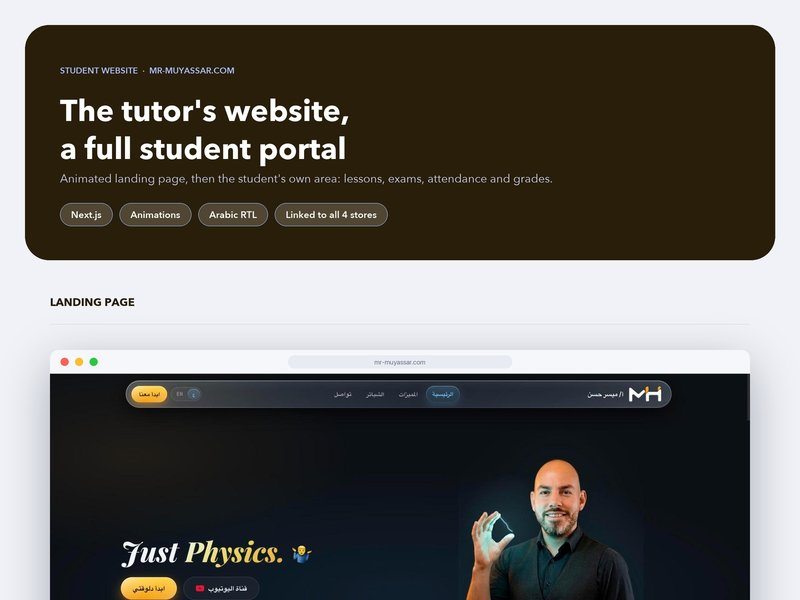
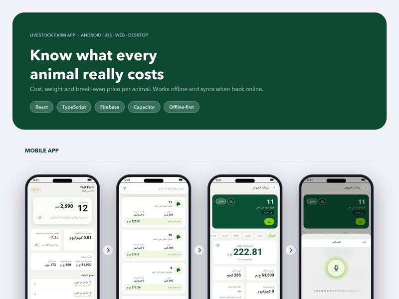
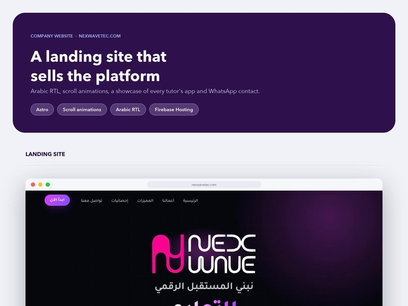

 

 

<table align="center">
<tr>
<td align="center" width="25%"><h2>28</h2>apps live on <b>Google Play</b></td>
<td align="center" width="25%"><h2>35+</h2>apps uploaded to <b>the App Store</b></td>
<td align="center" width="25%"><h2>300K+</h2>students installed <b>my apps</b></td>
<td align="center" width="25%"><h2>4</h2>stores: Play, Apple, <b>Huawei, Microsoft</b></td>
</tr>
</table>

## 👋 About me

Since 2019 I've built education apps for private tutors in Egypt. Every tutor gets a branded student app, a teacher app and a web dashboard, and I publish all of them myself on Google Play, the App Store, Huawei AppGallery and Microsoft Store.

The apps run real centers every day: protected video lessons, auto-graded exams, QR attendance at the door, online payments and WhatsApp reports to parents.

## 🛠️ What I can do for you

<table>
<tr>
<td width="50%" valign="top">

**📱 Flutter apps** 
Android, iOS, web, macOS and Windows from one codebase. New apps, or taking over and finishing an existing one.

**🎓 Education platforms** 
Courses, encrypted video (one device per student, no screen recording), exams, attendance, subscriptions and codes.

</td>
<td width="50%" valign="top">

**🚀 Store publishing** 
Signing, store listings, privacy forms, review rejections, TestFlight, and transferring apps between accounts.

**🔥 Firebase & dashboards** 
Auth, Firestore, Cloud Functions, push notifications, and Next.js admin dashboards.

</td>
</tr>
</table>

## 💼 Featured work

<table>
<tr>
<td width="50%" align="center">
 
<b>Student app</b>: protected video, exams with answer review, QR student card 

</td>
<td width="50%" align="center">
 
<b>Teacher app + web dashboard</b>: 481 students in one class, live exam stats, QR attendance 

</td>
</tr>
<tr>
<td width="50%" align="center">
 
<b>28 apps on our Google Play account</b>, several past 10K+ downloads 

</td>
<td width="50%" align="center">
 
<b>Student website</b>: animated Arabic landing page plus the full student area 

</td>
</tr>
<tr>
<td width="50%" align="center">
 
<b>Livestock farm app</b>: cost and break-even per animal, works offline 

</td>
<td width="50%" align="center">
 
<b>nexwavetec.com</b>: Arabic RTL website with scroll animations 

</td>
</tr>
</table>

## 🧰 Tech stack

## 📬 Let's work together

Most of my code is private client work, so the best way to see it is in the apps themselves. Download one from the links above, or message me and I'll walk you through how it's built.

 

